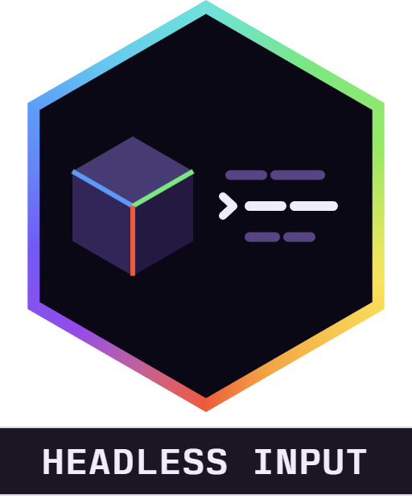

<div align="center">



# Alaydriem's Headless Input

[](https://github.com/alaydriem/amml-headless-input/releases)
[](https://github.com/alaydriem/amml-headless-input/actions/workflows/build.yml)
[](./LICENSE)

[](https://github.com/alaydriem/amml)

</div>

Drives the local player in Minecraft Bedrock with injected input. The input comes from an MCP client, one call at a time, or from an HCL control file that plays tick by tick. While a run is active, the mod manager blocks your keyboard and mouse. Real input comes back when the run ends.

Client-side only.

## Features

- Move, jump, sneak, sprint, turn, look at, attack, use, choose a hotbar slot and scroll
- Walk to a point, walk into a portal, join a server and leave a world
- Control files with steps, repeats and timeouts, counted in game ticks
- One MCP server for every game instance on the computer
- The run stops when you open the mod manager panel, a screen opens or the game stops ticking

## Installation

Install it with the [AMML launcher](https://github.com/alaydriem/amml/releases/latest). The launcher also installs the AMML loader and Alaydriem's Mod Manager, which this mod needs. Without the manager the mod cannot block input, so it stays off.

## Configuration

Settings are in the mod manager panel and saved to `mods/amml/@alaydriem/headless-input/config/config.hcl`.

| Setting | Default | Description |
| --- | --- | --- |
| `mcp.enabled` | `false` | Serves MCP from this instance |
| `mcp.allow_pairing` | `false` | Allows the MCP pairing request that waits. The mod turns it off again after each answer |
| `mcp.port` | `28250` | The MCP hub port (1024–65535) |
| `run.goal_timeout` | `"30s"` | The longest a goal step may run: `10s`, `30s`, `60s` or `120s` |
| `run.watchdog` | `"5s"` | The longest a run may go without a game tick: `2s`, `5s`, `10s` or `30s` |
| `live.idle` | `"30s"` | A live session ends after this long without a command: `10s`, `30s`, `60s` or `300s` |
| `files.folder` | `""` | The control-file folder. Empty is the mod data folder. To use another folder, set it in `config.hcl` |

## Connecting an MCP client

Turn on `mcp.enabled` first. A client must then pair once, and you approve the pairing in the game.

1. Send `POST http://127.0.0.1:28250/pair` (use your `mcp.port`) with the body `{"client":"<name>"}`. The name is 1 to 64 characters. The call waits for your answer.
2. In the game, open the mod manager panel and turn on "Allow MCP pairing" in the Headless Input settings. You have 60 seconds. If you do not turn it on, the request is denied.
3. The reply is `{"token":"..."}`. Send the token with every call to `http://127.0.0.1:28250/mcp` as the header `Authorization: Bearer <token>`.

`/pair` can also answer `403` (denied or no answer), `409` (another request waits) or `400` (bad body).

The token is saved in `%LOCALAPPDATA%\amml\mod-data\@alaydriem\headless-input\mcp.tokens.json`. All instances for your Windows user share it. On the first start after an update, a token file in the old folder `%LOCALAPPDATA%\amml\headless-input\` is copied there once, so clients you paired before keep working. If the loader is too old to give the shared folder, the file stays in the data folder of the instance, and the instances do not share it.

### MCP tools

| Tool | Does |
| --- | --- |
| `instances` | Lists the instances, the hub, and the state and features of each |
| `run_control_file` | Runs a control file, from a path or from text. Returns at once with a run id |
| `stop` | Ends the run or live session |
| `status` | Run state, step, ticks, last result, position, yaw, pitch and dimension |
| `move`, `jump`, `sneak`, `sprint` | Hold input |
| `turn`, `look_at` | Rotate the player |
| `attack`, `use` | Click or hold a mouse button |
| `hotbar`, `scroll` | Choose a slot, turn the wheel |
| `join_server`, `leave_world` | Join by address, return to the main menu |
| `release` | Ends the live session and gives input back |

To wait for a run to end, poll `status`.

A live session (the direct tools) ends on `release`, on `stop`, or after `live.idle` with no command.

### Several game instances

Each instance with `mcp.enabled` on tries to bind `127.0.0.1:28250`. The one that gets the port is the hub and serves MCP. The others register with the hub. If the hub game closes, another instance becomes the hub and your MCP connection keeps working.

An instance is named by its AMML instance folder. If you start two games from one folder, the second is named `<folder>-<process id>`.

Every tool takes an optional `instance`. With one instance you can leave it out. With more than one, a missing `instance` is an error that lists them. `run_control_file`, `stop` and `release` also accept `"*"` for all instances, and give one result per instance.

## Control files

A control file is HCL. A relative path is resolved against the `files.folder` of the hub, even when `instance` names another instance.

```hcl
name = "example"

defaults {
  goal_timeout = "30s"
}

step "move" {
  hold = ["forward"]
  for  = "2s"
}

repeat {
  count = 3

  step "turn" {
    yaw  = 90
    over = "10t"
  }
}
```

The top level holds `name` (optional), one optional `defaults` block, `step` blocks and `repeat` blocks. Other blocks and unknown attributes are errors, and an error names its line.

### Durations

A duration is text. `"5s"` is 5 seconds (100 ticks). `"12t"` is 12 ticks. Seconds can have decimals. The game runs at 20 ticks a second. The shortest duration is 1 tick and the longest is one hour. The mod counts game ticks, not wall-clock time.

`defaults` holds one attribute, `goal_timeout`: the timeout of a goal step that does not set its own.

### Steps

A `step` has one label, its kind.

| Kind | Attributes | Does |
| --- | --- | --- |
| `move` | `hold` (a key or a list of keys), `for` | Holds keys. Keys: `forward`, `back`, `left`, `right`, `jump`, `sneak`, `sprint` |
| `jump` | `for` (default 1 tick) | Holds jump |
| `sneak` | `for` | Holds sneak |
| `sprint` | `for` | Holds sprint |
| `wait` | `for` | Does nothing |
| `turn` | `yaw`, `pitch`, `over` | Turns by this many degrees over the time. A missing `yaw` or `pitch` is 0 |
| `look_at` | `yaw`, `pitch`, `over` | Turns to this yaw and pitch over the time. All three are needed |
| `attack` | `hold` (optional) | Clicks attack, or holds it for `hold` |
| `use` | `hold` (optional) | Clicks use, or holds it for `hold` |
| `hotbar` | `slot` (1–9) | Chooses a hotbar slot |
| `scroll` | `steps` (not 0) | Turns the mouse wheel this many notches. The sign sets the direction |
| `command` | `text` (1 to 256 bytes, starts with `/`, no newline) | Sends one slash command to the server as the local player, once, and ends on the next tick. Commands such as `/tp` need cheats on, or operator permission on the server |
| `walk_to` | `x`, `z`, `y` (optional), `within` (default 0.5, at least 0.3), `sprint` (default false), `timeout` | Walks to a point and ends within `within` blocks of it |
| `walk_until_dimension` | `dimension` (`overworld`, `nether`, `end`), `timeout` | Walks forward until the player enters that dimension. Without `dimension`, until the dimension changes |
| `join_server` | `address`, `port` (default 19132), `timeout` | Joins a server. A run can start at the main menu |
| `leave_world` | `timeout` | Leaves the world for the main menu |

`walk_to`, `walk_until_dimension`, `join_server` and `leave_world` are goal steps. A goal step without `timeout` uses `goal_timeout`. If it passes its timeout, the run fails. The timeouts of `join_server` and `leave_world` count wall-clock time, because no world ticks at the main menu.

`walk_until_dimension` never ends if the player is already in the named dimension, so it times out.

If the game build lacks a read that a goal step needs, the file is refused with the line of that step. Time steps still work.

### Repeat

```hcl
repeat {
  count   = 5
  timeout = "2m"

  step "wait" { for = "1s" }
}
```

`count` is 1 or more. `timeout` is a duration. A `repeat` needs `count`, `timeout` or both. With no `count` it repeats until the timeout or until the run stops. A `repeat` can hold steps and other `repeat` blocks.

### Limits

| Limit | Value |
| --- | --- |
| File size | 65536 bytes |
| Nested `repeat` depth | 4 |
| Steps, after repeats expand | 512 |
| Total run length | 72000 ticks (one hour) |

### Examples

[`examples/`](./examples) holds working files. Change the coordinates to fit your world.

- `square.hcl`: walk a square with time steps
- `square_tp.hcl`: the same square, started by a `/tp` command
- `walk_to.hcl`: two `walk_to` waypoints
- `mine_loop.hcl`: attack and turn, five times
- `portal.hcl`: walk into the Nether and back
- `join.hcl`: join a local server, walk, leave

## How a run ends

| Result | Cause |
| --- | --- |
| done | The last step finished |
| stopped | The `stop` tool, or you opened the mod manager panel |
| aborted | No game tick for the `run.watchdog` time |
| aborted | Another mod took the input claim |
| aborted | The mod was turned off |
| aborted | An internal error. The mod stays idle until you turn it off and on again |
| aborted | The run took more than twice its planned length in wall-clock time (at least 1 second). A goal timeout counts in full |
| aborted | The world was left, except during `join_server`, `leave_world` and a portal loading screen |
| failed | A goal step passed its timeout, or a join was refused |
| failed | A screen opened over the world (pause menu, death screen, server form, chat). The result names the screen. A toast is not a screen |

During `join_server` and `leave_world`, the watchdog, the screen rule and the world-left rule are paused, and the step timeout counts wall-clock time. During a portal loading screen, the watchdog and the world-left rule are paused.

A run that the panel stopped does not start again when the panel closes.

## Building

Requires Windows x64, [mise](https://mise.jdx.dev), rustup and [cargo-nextest](https://nexte.st).

```powershell
mise trust
mise run preflight
mise run package
mise run test
```

## License

BSD 3-Clause. Copyright (c) 2026 Charles R. Portwood II. See [LICENSE](./LICENSE).
